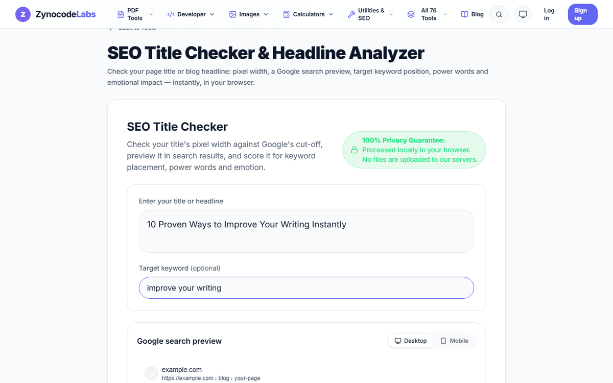
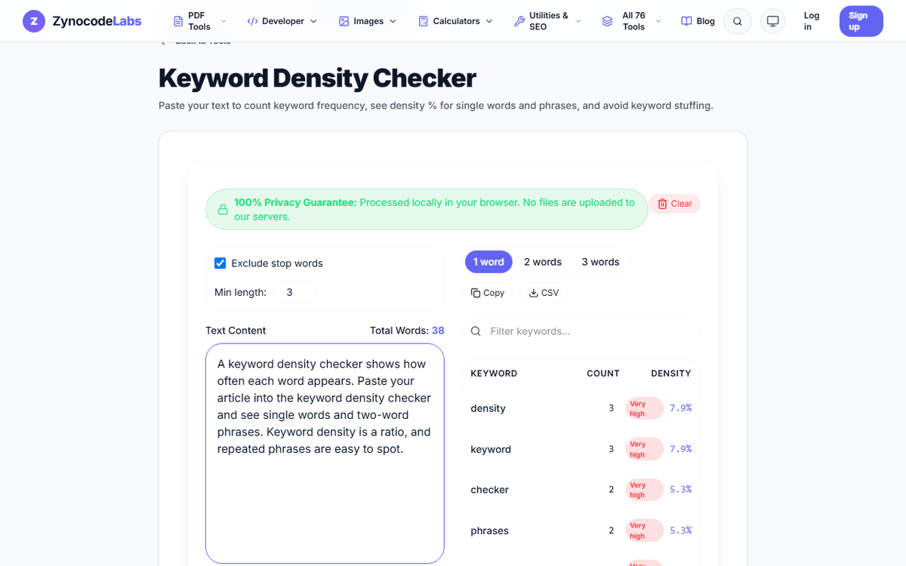
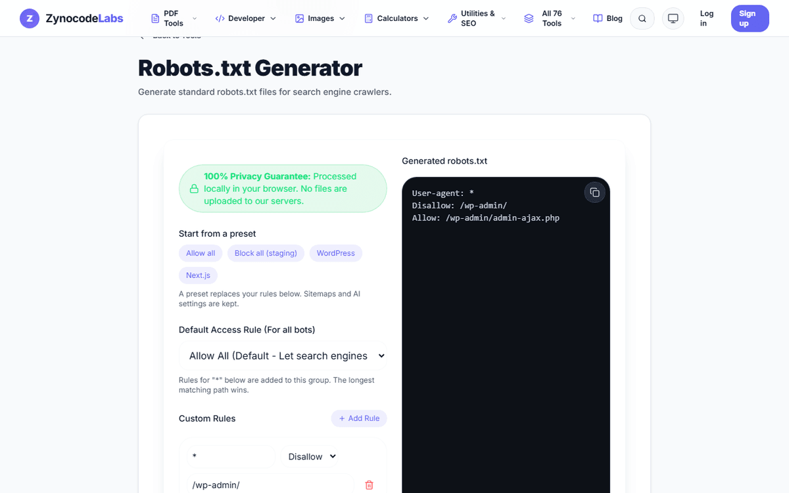
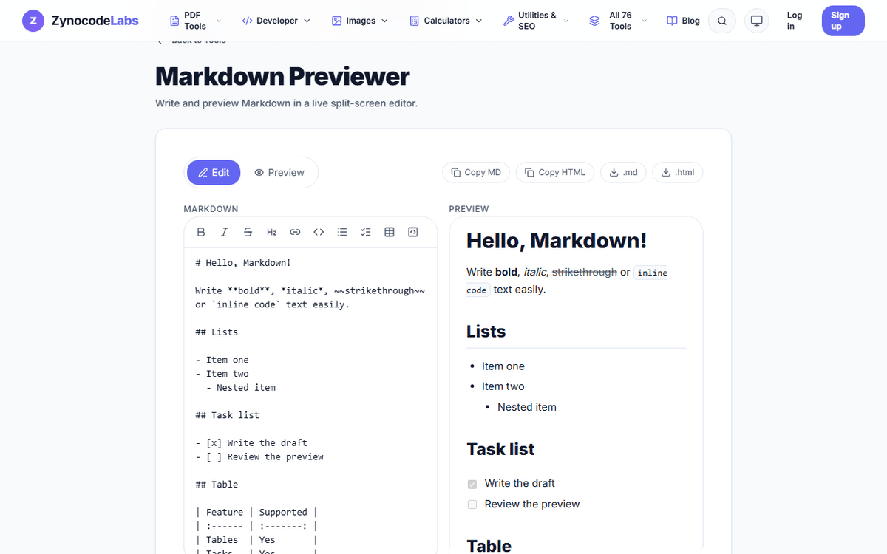
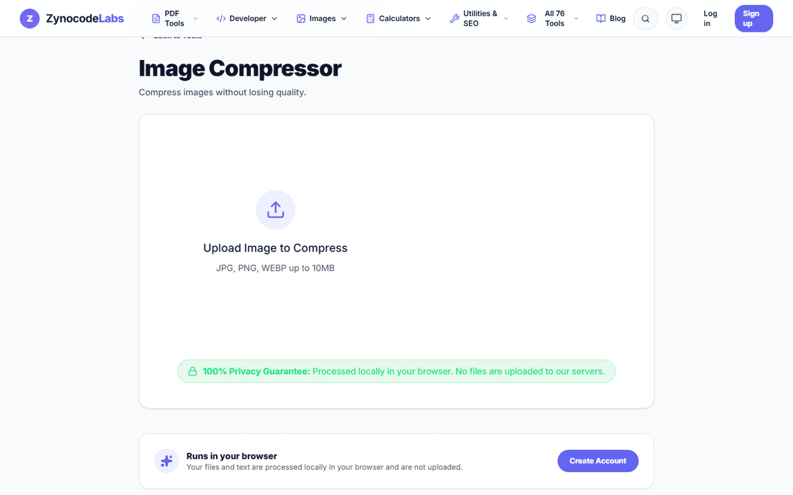
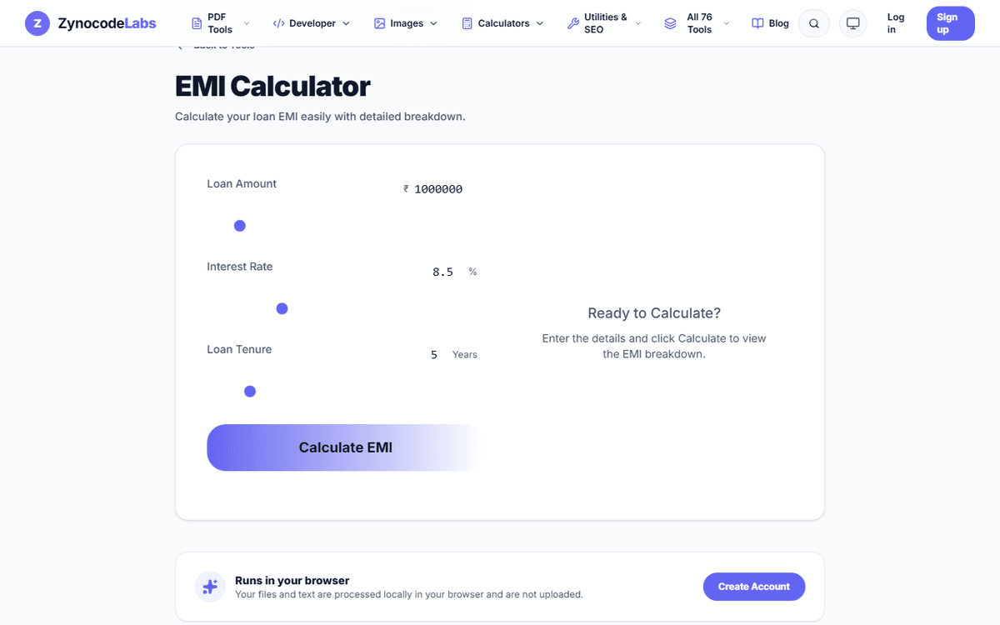

# Zynocode Labs — 76 Free Online Tools

Free tools for PDF, images, SEO, writing, developers and finance at **[labs.zynocode.com](https://labs.zynocode.com)**. No signup needed, and most tools run in your browser, so your files aren't uploaded.

This repository is a showcase and index of the tools. The tools themselves live on the website.

<p align="center">
  
  
</p>

## Contents

- [Developer Packages](#developer-packages)
- [Free Online PDF Tools](#free-online-pdf-tools) (5)
- [Free Online Image Tools](#free-online-image-tools) (8)
- [Free SEO Tools](#free-seo-tools) (8)
- [Free Online Writing Tools](#free-online-writing-tools) (13)
- [Free Online Developer Tools](#free-online-developer-tools) (18)
- [Free Financial Calculators](#free-financial-calculators) (19)
- [Free Online Utilities](#free-online-utilities) (5)
- [Guides](#guides)
- [Privacy](#privacy)

## Developer Packages

Official open-source client libraries and terminal tools for interacting with the [Zynocode Labs API](https://labs.zynocode.com/developers/api-reference):

| Package | Install | Documentation | Source |
|---|---|---|---|
| **[@zynocode/sdk](https://www.npmjs.com/package/@zynocode/sdk)** | `npm install @zynocode/sdk` | [TypeScript SDK Guide](https://labs.zynocode.com/developers/sdk) | [`packages/sdk`](packages/sdk) |
| **[zynocode](https://www.npmjs.com/package/zynocode)** | `npm install -g zynocode` | [CLI Reference](https://labs.zynocode.com/developers/cli) | [`packages/cli`](packages/cli) |

### Additional Developer Resources

- [REST API Reference](https://labs.zynocode.com/developers/api-reference) — HTTP endpoints, request/response models, and error codes
- [Model Context Protocol (MCP)](https://labs.zynocode.com/developers/mcp) — Claude Desktop and Cursor integration via stdio and HTTP
- [Webhooks Guide](https://labs.zynocode.com/developers/webhooks) — Event notifications and HMAC-SHA256 signature verification

### Repository Structure

```
zynocode-labs-free-tools/
├── packages/
│   ├── sdk/    # @zynocode/sdk source (TypeScript API client)
│   └── cli/    # zynocode source (Terminal CLI & MCP server)
├── docs/       # Showcase screenshots and visual assets
├── LICENSE     # Repository documentation & assets license (CC BY 4.0)
└── README.md   # Showcase catalog and developer package index
```

## Free Online PDF Tools

[Browse them on the site](https://labs.zynocode.com/tools/category/pdf)

| Tool | What it does |
|---|---|
| [PDF Compressor](https://labs.zynocode.com/tools/pdf-compressor) | Compress PDF files to reduce file size while maintaining quality. |
| [PDF Merger](https://labs.zynocode.com/tools/pdf-merger) | Combine multiple PDF files into a single document. |
| [PDF Splitter](https://labs.zynocode.com/tools/pdf-splitter) | Extract specific pages from a PDF document. |
| [Images to PDF](https://labs.zynocode.com/tools/images-to-pdf) | Convert JPG and PNG images into a single PDF document. |
| [PDF to Images](https://labs.zynocode.com/tools/pdf-to-images) | Extract pages from a PDF document as high-quality images. |

## Free Online Image Tools

[Browse them on the site](https://labs.zynocode.com/tools/category/images)

| Tool | What it does |
|---|---|
| [Image Cropper](https://labs.zynocode.com/tools/image-cropper) | Crop and resize images precisely for social media. |
| [Image Compressor](https://labs.zynocode.com/tools/image-compressor) | Compress images without losing quality. |
| [Image Resizer](https://labs.zynocode.com/tools/image-resizer) | Resize images to any custom width and height in seconds. |
| [Image to WebP](https://labs.zynocode.com/tools/image-to-webp) | Convert JPG/PNG/HEIC images to highly optimized WebP format. |
| [JPEG to PNG Converter](https://labs.zynocode.com/tools/jpeg-to-png) | Convert JPEG/JPG images to PNG format instantly. |
| [JPEG to WebP Converter](https://labs.zynocode.com/tools/jpeg-to-webp) | Convert JPEG/JPG images to optimized WebP format. |
| [Image to Base64](https://labs.zynocode.com/tools/image-to-base64) | Convert any image to a Base64 data string for inline embedding. |
| [AI Background Remover](https://labs.zynocode.com/tools/background-remover) | Remove image backgrounds instantly and securely using on-device AI. |

## Free SEO Tools

[Browse them on the site](https://labs.zynocode.com/tools/category/seo)

| Tool | What it does |
|---|---|
| [Meta Tag Generator](https://labs.zynocode.com/tools/meta-tag-generator) | Generate SEO-friendly meta tags for your website. |
| [Robots.txt Generator](https://labs.zynocode.com/tools/robots-txt-generator) | Generate standard robots.txt files for search engine crawlers. |
| [Schema Markup Generator](https://labs.zynocode.com/tools/schema-markup-generator) | Create JSON-LD structured data for rich snippets in Google. |
| [Keyword Density Checker](https://labs.zynocode.com/tools/keyword-density-checker) | Analyze text for keyword frequency and density to avoid stuffing. |
| [.htaccess Generator](https://labs.zynocode.com/tools/htaccess-generator) | Generate Apache .htaccess rules for 301 redirects and HTTPS. |
| [llms.txt Generator](https://labs.zynocode.com/tools/llms-txt-generator) | Create an llms.txt file to guide AI agents parsing your website. |
| [SERP Preview Tool](https://labs.zynocode.com/tools/serp-preview-tool) | Preview how your webpage title and description will look on Google. |
| [UTM Link Builder](https://labs.zynocode.com/tools/utm-builder) | Generate UTM tracking URLs for marketing campaigns. |

## Free Online Writing Tools

[Browse them on the site](https://labs.zynocode.com/tools/category/writing)

| Tool | What it does |
|---|---|
| [Text Cleaner](https://labs.zynocode.com/tools/text-cleaner) | Instantly remove extra spaces, empty lines, and clean messy text. |
| [Readability Checker](https://labs.zynocode.com/tools/readability-checker) | Calculate Flesch-Kincaid readability score and grade level for your text. |
| [Data Extractor](https://labs.zynocode.com/tools/data-extractor) | Extract emails, URLs, and phone numbers from raw text using regex. |
| [URL Slug Generator](https://labs.zynocode.com/tools/slug-generator) | Convert titles and phrases into clean, SEO-friendly URL slugs. |
| [List Sorter](https://labs.zynocode.com/tools/list-sorter) | Alphabetize lists, sort by length, and remove duplicates easily. |
| [Word Counter](https://labs.zynocode.com/tools/word-counter) | Count words, characters, and reading time in real-time. |
| [Headline Analyzer](https://labs.zynocode.com/tools/headline-analyzer) | Analyze and score titles for better engagement and click-through rates. |
| [Passive Voice Detector](https://labs.zynocode.com/tools/passive-voice-detector) | Identify passive voice, clichés, and fluff words in your writing. |
| [Markdown to HTML](https://labs.zynocode.com/tools/markdown-to-html) | Convert Markdown instantly to HTML and Rich Text formats. |
| [Social Media Formatter](https://labs.zynocode.com/tools/social-media-formatter) | Draft posts and check character limits for Twitter, LinkedIn, and Instagram. |
| [Duplicate Word Finder](https://labs.zynocode.com/tools/duplicate-word-finder) | Find and highlight overused words in your text. |
| [Text Summarizer](https://labs.zynocode.com/tools/text-summarizer) | Automatically extract the most important sentences from your text. |
| [AI Text Humanizer](https://labs.zynocode.com/tools/text-humanizer) | Rewrite robotic AI text to sound more natural, engaging, and human. |

## Free Online Developer Tools

[Browse them on the site](https://labs.zynocode.com/tools/category/developer)

| Tool | What it does |
|---|---|
| [JSON Formatter](https://labs.zynocode.com/tools/json-formatter) | Format, validate, and minify JSON with syntax highlighting. |
| [Base64 Encoder](https://labs.zynocode.com/tools/base64-encoder) | Encode and decode text or files to and from Base64. |
| [Hash Generator](https://labs.zynocode.com/tools/hash-generator) | Generate SHA-1, SHA-256, SHA-384, and SHA-512 hashes instantly. |
| [URL Encoder](https://labs.zynocode.com/tools/url-encoder) | Encode and decode URL components for safe transmission. |
| [Color Converter](https://labs.zynocode.com/tools/color-converter) | Convert colors between HEX, RGB, and HSL formats with live preview. |
| [Case Converter](https://labs.zynocode.com/tools/case-converter) | Convert text to UPPERCASE, lowercase, camelCase, snake_case, and more. |
| [Lorem Ipsum Generator](https://labs.zynocode.com/tools/lorem-ipsum) | Generate placeholder text for paragraphs, sentences, or words. |
| [Markdown Previewer](https://labs.zynocode.com/tools/markdown-previewer) | Write and preview Markdown in a live split-screen editor. |
| [Regex Tester](https://labs.zynocode.com/tools/regex-tester) | Test and debug regular expressions with live match highlighting. |
| [Diff Checker](https://labs.zynocode.com/tools/diff-checker) | Compare two blocks of text and highlight the differences. |
| [CSS Gradient Generator](https://labs.zynocode.com/tools/css-gradient-generator) | Create and preview beautiful CSS gradients easily. |
| [SVG Optimizer](https://labs.zynocode.com/tools/svg-optimizer) | Clean and compress SVG files by removing unnecessary code. |
| [JSON to CSV](https://labs.zynocode.com/tools/json-to-csv) | Convert JSON arrays or objects into CSV format instantly. |
| [JWT Decoder](https://labs.zynocode.com/tools/jwt-decoder) | Decode JSON Web Tokens locally without sending them to a server. |
| [XML Formatter](https://labs.zynocode.com/tools/xml-formatter) | Format and beautify raw XML code into a readable structure. |
| [UUID Generator](https://labs.zynocode.com/tools/uuid-generator) | Generate standard v4 UUIDs/GUIDs in bulk. |
| [CSV to JSON](https://labs.zynocode.com/tools/csv-to-json) | Convert CSV text or files into formatted JSON arrays. |
| [Bcrypt Generator](https://labs.zynocode.com/tools/bcrypt-generator) | Generate and verify Bcrypt hashes with custom salt rounds. |

## Free Financial Calculators

[Browse them on the site](https://labs.zynocode.com/tools/category/finance)

| Tool | What it does |
|---|---|
| [EMI Calculator](https://labs.zynocode.com/tools/emi-calculator) | Calculate your loan EMI easily with detailed breakdown. |
| [GST Calculator](https://labs.zynocode.com/tools/gst-calculator) | Instant GST calculation for inclusive and exclusive amounts. |
| [SIP Calculator](https://labs.zynocode.com/tools/sip-calculator) | Calculate mutual fund SIP returns with inflation adjustment. |
| [Compound Interest](https://labs.zynocode.com/tools/compound-interest-calculator) | Visualize the power of compounding with regular contributions. |
| [Loan Amortization](https://labs.zynocode.com/tools/loan-amortization-schedule) | Generate loan schedules with advanced prepayment options. |
| [Retirement Planner](https://labs.zynocode.com/tools/retirement-calculator) | Calculate required corpus and SIP to retire comfortably. |
| [FD & RD Calculator](https://labs.zynocode.com/tools/fd-rd-calculator) | Calculate maturity values for Fixed and Recurring Deposits. |
| [Debt Payoff Calculator](https://labs.zynocode.com/tools/debt-payoff-calculator) | Compare Snowball and Avalanche methods to become debt-free faster. |
| [Emergency Fund Planner](https://labs.zynocode.com/tools/emergency-fund-planner) | Calculate and track your financial security milestones. |
| [Rent vs. Buy Calculator](https://labs.zynocode.com/tools/rent-vs-buy-calculator) | Compare long-term net worth of buying vs renting a home. |
| [Salary & Hourly Estimator](https://labs.zynocode.com/tools/salary-estimator) | Convert between annual, hourly, and estimate take-home pay. |
| [50/30/20 Budget Planner](https://labs.zynocode.com/tools/budget-50-30-20-planner) | Divide your after-tax income into needs, wants, and savings. |
| [Inflation Calculator](https://labs.zynocode.com/tools/inflation-calculator) | See how inflation erodes your purchasing power over time. |
| [Net Worth Calculator](https://labs.zynocode.com/tools/net-worth-calculator) | Calculate your true wealth by subtracting liabilities from assets. |
| [Mortgage Payoff Calculator](https://labs.zynocode.com/tools/mortgage-payoff-calculator) | See time and interest saved by making extra monthly payments. |
| [ROI Calculator](https://labs.zynocode.com/tools/roi-calculator) | Calculate Return on Investment (ROI) and annualized return. |
| [Credit Card Payoff](https://labs.zynocode.com/tools/credit-card-payoff-calculator) | Calculate time and interest required to pay off credit card debt. |
| [Savings Goal Calculator](https://labs.zynocode.com/tools/savings-goal-calculator) | Calculate how much you need to save to reach your financial goals. |
| [Lumpsum Calculator](https://labs.zynocode.com/tools/lumpsum-calculator) | Calculate future value of a one-time lumpsum investment. |

## Free Online Utilities

[Browse them on the site](https://labs.zynocode.com/tools/category/utilities)

| Tool | What it does |
|---|---|
| [QR Code Generator](https://labs.zynocode.com/tools/qr-generator) | Generate QR codes for URLs, text, and more. |
| [Password Generator](https://labs.zynocode.com/tools/password-generator) | Generate strong, secure random passwords instantly. |
| [Unit Converter](https://labs.zynocode.com/tools/unit-converter) | Convert between length, weight, temperature, and more. |
| [YouTube Thumbnail Downloader](https://labs.zynocode.com/tools/youtube-thumbnail-downloader) | Extract and download YouTube video thumbnails in HD. |
| [Text to Speech Reader](https://labs.zynocode.com/tools/text-to-speech) | Convert text to natural sounding speech using browser voices. |

## Screenshots

    

## Guides

Practical guides from the [Zynocode Labs blog](https://labs.zynocode.com/guides):

- [Bcrypt Password Hashing Explained: Cost Factors, Salts & Architecture](https://labs.zynocode.com/guides/bcrypt-password-hashing-explained)
- [bcrypt vs Argon2id vs scrypt: Which Password Hashing Algorithm Should You Use?](https://labs.zynocode.com/guides/bcrypt-vs-argon2-vs-scrypt)
- [Credit Card Interest in India: How It Is Calculated and the Minimum Due Trap](https://labs.zynocode.com/guides/credit-card-interest-minimum-due)
- [FD vs RD: Which Earns More Interest and When Should You Choose Each?](https://labs.zynocode.com/guides/fd-vs-rd-which-is-better)
- [Flesch Reading Ease Explained: Formulas, Score Meaning & Charts](https://labs.zynocode.com/guides/readability-score-flesch-kincaid-explained)
- [GST on Services in India: Current Slabs, SAC Codes & Invoicing Rules](https://labs.zynocode.com/guides/gst-on-services-india)
- [Home Loan Prepayment: Should You Reduce EMI or Loan Tenure?](https://labs.zynocode.com/guides/home-loan-prepayment-reduce-emi-or-tenure)
- [How to Calculate Loan EMI: Mathematical Formula & Worked Example](https://labs.zynocode.com/guides/how-to-calculate-emi)
- [How to Calculate Net Worth: The Complete Step-by-Step Guide](https://labs.zynocode.com/guides/how-to-calculate-net-worth)
- [JWT Structure Explained: Header, Payload, Signature & Security Rules](https://labs.zynocode.com/guides/jwt-structure-explained)
- [Listen to Text: How to Proofread Writing and Study by Ear](https://labs.zynocode.com/guides/free-online-text-reader-guide)
- [Markdown Cheat Sheet: Syntax, Tables, and Live Preview Guide](https://labs.zynocode.com/guides/markdown-cheat-sheet-preview)
- [MD5 vs SHA-256: Differences, Collision Vulnerabilities & Modern Security Rules](https://labs.zynocode.com/guides/md5-vs-sha256)
- [Meta Description Length Guide: Ideal Characters, Pixels & High-CTR Templates](https://labs.zynocode.com/guides/google-serp-preview-meta-description-guide)
- [Passive Voice Examples: How to Spot and Convert Passive Sentences](https://labs.zynocode.com/guides/passive-voice-checker-examples)
- [Photo and Signature Size for Online Forms: Requirements and Compression Guide](https://labs.zynocode.com/guides/compress-photo-signature-for-online-forms)
- [Robots.txt Guide: Syntax Rules, Best Practices, and 10 Working Examples](https://labs.zynocode.com/guides/robots-txt-guide-examples)
- [SEO Title Tag Length Guide: How to Craft Click-Worthy Google Titles](https://labs.zynocode.com/guides/seo-title-tag-length-guide)
- [UTM Parameters Guide: How to Track Campaigns in Google Analytics 4](https://labs.zynocode.com/guides/utm-parameters-guide-ga4)
- [UUID v4 vs UUID v7: Which Unique Identifier Should You Use for Database Keys?](https://labs.zynocode.com/guides/uuid-v4-vs-v7)
- [What Is Keyword Density? Complete Formula, Examples & SEO Guide](https://labs.zynocode.com/guides/what-is-keyword-density)

## Privacy

Most tools process your files and text in your browser, so they aren't uploaded to our servers. The Text to Speech tool marks voices that are generated online by your browser vendor. See the [privacy policy](https://labs.zynocode.com/privacy).

## Feedback

Found a bug or want a new tool? [Open an issue](https://github.com/zynocode/zynocode-labs-free-tools/issues) or use the [contact page](https://labs.zynocode.com/contact).

## License

The documentation and screenshots in this repository are licensed under [CC BY 4.0](LICENSE). The packages in `packages/` are each licensed under the [MIT License](packages/sdk/LICENSE). The Zynocode Labs website and its proprietary web application source code are not part of this repository.
